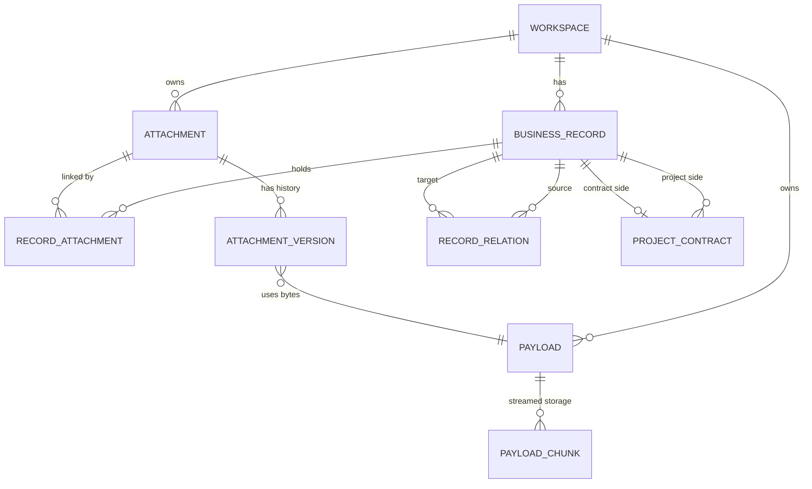

# IPSys M0 统一字段、状态与实体字典（设计初稿 V0.1）

> 阶段：M0 设计输入准备，2026-10-13  
> 依据：[REQUIREMENTS.md](./REQUIREMENTS.md) V1.0 冻结范围与 [FREEZE_AUDIT.md](./FREEZE_AUDIT.md)  
> **本文件是 M0 设计交付物，不是对已冻结需求的修改，也不是已实现的数据库 Schema。**  
> 状态：**字段覆盖与关系草图已形成；涉及知识产权详细枚举及少量字段候选的内容待一次性设计审阅。** 未经审阅，不能把建议项写成用户已确认事项。

## 1. 使用方式、标记与类型约定

本字典是表单、SQLite 逻辑模型、检索和 Excel 模板的共同输入。前端显示名与内部逻辑字段标识保持一一对应；最终物理表名、索引、SQLite 类型与分块策略在 M1/M2 验证后确定。

字段标记：

| 记号 | 含义 | 使用规则 |
| --- | --- | --- |
| **F** | 冻结需求中明确的字段或业务规则 | 必须实现，不能在技术设计时擅自删除 |
| **D** | 为落实 F 作出的字段拆解、数据表示或默认映射 | 可在 M2 优化实现，但不得改变对应业务含义 |
| **P** | 冻结需求仅提出总体意图、尚未逐项明确的设计建议 | 先集中审阅；**不能声称是用户已确认的最终字段或枚举** |
| **I** | 系统内部主键、外键、校验及文件管理元数据 | 不强制显示到业务表单、Excel，不视为新业务必填项 |

常用逻辑数据类型：文本（保留前后所输入业务值的实际内容）、长文本、日期（仅日期不含时区）、十进制金额、固定枚举、可编辑分类、标签集合、系统 UUID/整型 ID。人员/单位多值信息仍是**单个文本字段**，不拆成人员子表、不排序。空日期/编号/金额允许留空，空值不等于 0 或某个“未知”状态。项目默认状态另见第 4 节。

各模块都有内部 `record_id`、`workspace_id`（I）；附件二进制及路径不作为台账 Excel 字段。除明确约束的业务类型外，业务类别与子类别的扩展不得擅自改变固定类型字典。

## 2. 工作区、模块与强制业务关系

| 模块标识 | 公司工作区 | 个人工作区 | 新建入口/限制 | 已确认业务规则 |
| --- | --- | --- | --- | --- |
| `ip` 知识产权 | 是 | 是 | 模块新建 | 名称、类型必填；按类型显示状态和专用字段（Q79–84） |
| `project` 项目 | 是 | 是 | 模块新建 | 名称、项目类别必填；状态默认为筹备中（Q69–73、Q119） |
| `contract` 合同 | 是 | 是 | **只能从所属项目详情新建** | 合同名称必填；每份合同有且仅有一个项目；允许全合同汇总检索、导出，不允许汇总页新增（Q69、Q74–78） |
| `company_certificate` 企业资质/证书 | 是 | 否 | 模块新建 | 仅名称必填；无专用编号/发证机关/有效期字段（Q137–138） |
| `personal_certificate` 个人证件 | 否 | 是 | 模块新建 | 身份、学历、职称、资格等统一入口；仅名称必填（Q118–120、Q137–138） |
| `research_output` 科研成果 | 是 | 是 | 模块新建 | 仅名称必填，所有成果类型使用相同极简字段（Q139） |
| `general` 综合资料 | 是 | 是 | 模块新建 | 仅名称必填，类别默认为综合资料（Q111） |

工作台、全部合同视图、关联资料视图不是新的可创建业务记录类型。公司与个人共享系统程序和加密数据库，但所有记录/引用/二进制都以工作区为范围；跨工作区复制时须生成独立数据副本（Q5、Q61、Q112）。

## 3. 各模块统一字段清单

### 3.1 知识产权公共字段（`ip`）

| 逻辑标识 | 显示字段 | 类型 | 必填 | 默认/适用性 | 依据 |
| --- | --- | --- | --- | --- | --- |
| `name` | 名称 | 文本 | **是** | 所有知识产权 | F，Q79 |
| `ip_type` | 知识产权类型 | 固定枚举 | **是** | 第 4.1 节的七种固定类型 | F，Q24–25、Q79 |
| `status` | 状态 | 按 `ip_type` 的固定枚举 | 否 | 完整取值见第 4.2 节**设计候选** | F（字段），P（完整取值）；Q80 |
| `applicants` | 申请人 | 文本 | 否 | 支持多个姓名/单位按原样写在一格 | F，Q26、Q82 |
| `right_holders` | 当前权利人 | 文本 | 否 | 支持多个姓名/单位，保留原输入顺序 | F，Q81–82 |
| `creators` | 发明人／作者 | 文本 | 否 | 按 IP 类型显示“发明人”或“作者”；**不拆成个人主数据** | F（信息与顺序），D（复用同一逻辑字段）；Q82 |
| `remarks` | 备注 | 长文本 | 否 | 所有类型 | F，Q81 |
| `tags` | 标签 | 标签集合 | 否 | 记录级别，不附着在附件上 | F，Q62 |
| `application_no` | 申请号 | 文本 | 否 | 专利类型；其它类型是否使用由字段方案决定 | F（专利），Q79、Q81 |
| `application_date` | 申请日 | 日期 | 否 | 专利类型 | F，Q79、Q81 |
| `publication_info` | 公开／授权公告信息 | 文本 | 否 | 专利类型，记录对应公开/公告信息 | F（信息范畴），D（暂用单一字段）；Q81 |
| `grant_date` | 授权日 | 日期 | 否 | 专利类型 | F，Q79、Q81 |
| `registration_no` | 登记号 | 文本 | 否 | 软件著作权；其它需登记类型见候选 | F（软件著作权），Q79、Q81 |
| `first_published_date` | 首次发表日期 | 日期 | 否 | 软件著作权 | F，Q81 |
| `registration_date` | 登记日期 | 日期 | 否 | 软件著作权 | F，Q79、Q81 |

业务记录的附件在另一个附件列表中管理，不增加 Excel 的“文件路径”“材料清单”“附件正文”列。申请人、权利人及发明人/作者字段不做顺序重排。软件著作权缺少首次发表日期时可留空，不添加伪造的日期。

### 3.2 知识产权类型专用字段候选（尚未经最终确认）

固定需求只对**专利类的申请/公开/授权信息**、**软件著作权的登记/发表日期**有明确举例；其它类型不应凭常识就宣称字段已获确认。为让前端/Excel 设计能够一次性评审，下面列出候选字段差异，M2 选定之前保留“P”标记。

| 类型 | 已确认必须支持的专用信息 | 拟补充/细化字段（P） | M0 建议 |
| --- | --- | --- | --- |
| 发明专利 | 申请号、申请日、公开/授权公告信息、授权日期 | `publication_no` 公开号、`publication_date` 公开日、`grant_notice_no` 授权公告号 | 若采用拆分列，原“公开/授权公告信息”保留兼容归档；具体列须集中评审 |
| 实用新型专利 | 申请号、申请日、公开/授权公告信息、授权日期 | 授权公告号、公告日 | 尽可能与其它专利共用字段结构，避免强制无意义的公开字段 |
| 外观设计专利 | 申请号、申请日、公开/授权公告信息、授权日期 | 授权公告号、公告日 | 复用专利通用字段 |
| 软件著作权 | 登记号、首次发表日期、登记日期 | 暂不建议补充专门字段 | 按已确认字段即可 |
| 其他著作权 | 仅公共字段明确，登记信息尚未逐项确认 | 登记号、登记日期 | 可作为可选候选，不能擅自列为必填 |
| 商标 | 仅公共字段明确，专用字段尚未逐项确认 | 申请/注册号、申请日、注册日期 | P，后续一次性审查 |
| 集成电路布图设计 | 仅公共字段明确，专用字段尚未逐项确认 | 登记号、申请日、登记日期 | P，后续一次性审查 |

**不能因提出候选字段就改变“名称与 IP 类型为唯二必填项”的已确认规则**。对于尚未定稿的 P 字段，首轮真实 Schema/正式 Excel 模板只在其被审阅通过后生成。

### 3.3 项目（`project`）

| 逻辑标识 | 显示字段 | 类型 | 必填 | 默认值 | 依据 |
| --- | --- | --- | --- | --- | --- |
| `name` | 项目名称 | 文本 | **是** | 无 | F，Q72 |
| `project_type` | 项目类别 | 固定枚举 | **是** | 无；科研项目／横向项目／其他项目 | F，Q70–72 |
| `project_no` | 项目编号 | 文本 | 否 | 空 | F，Q72 |
| `leader` | 负责人 | 文本 | 否 | 空 | F，Q72 |
| `undertaking_org` | 承担单位 | 文本 | 否 | 空 | F，Q72 |
| `start_date` | 开始日期 | 日期 | 否 | 空 | F，Q72 |
| `end_date` | 结束日期 | 日期 | 否 | 空 | F，Q72 |
| `project_status` | 项目状态 | 固定枚举 | 否 | **筹备中** | F，Q73 |
| `remarks` | 备注 | 长文本 | 否 | 空 | F，Q72 |
| `tags` | 标签 | 标签集合 | 否 | 空 | F，Q62 |

三种项目类型共用这些字段；不设置“经费”“预算”“阶段进度”等管理列。开始结束日期允许为空，只有两者都有值时才可进行必要的先后校验；不以补齐日期为保存条件。

### 3.4 合同（`contract`）

| 逻辑标识 | 显示字段 | 类型 | 必填 | 默认值/约束 | 依据 |
| --- | --- | --- | --- | --- | --- |
| `name` | 合同名称 | 文本 | **是** | 无 | F，Q74 |
| `project_id` | 所属项目 | 内部关联 | **是（系统继承）** | 只能在项目详情中新增，不由用户填业务编号 | F，Q69、Q74 |
| `contract_no` | 合同编号 | 文本 | 否 | 空 | F，Q74 |
| `sign_date` | 签订日期 | 日期 | 否 | 空 | F，Q74 |
| `amount` | 合同金额 | 十进制金额 | 否 | 空不等于 0；**默认人民币（CNY），显示格式 `0.00`**，不补额外的前导零；未填写仍为空 | F（字段），D（数值表示）；Q30、Q74 |
| `signing_parties` | 签约主体 | 文本 | 否 | 单一原样文本，不建立企业表 | F，Q74 |
| `remarks` | 备注 | 长文本 | 否 | 空 | F（通用备注），Q62 |
| `tags` | 标签 | 标签集合 | 否 | 空 | F，Q62 |

“全部合同”列表及 Excel 导出附加只读 `project_name`（所属项目名称，D，来源为既有项目关联），用于说明归属，不能从汇总视图新增独立合同。合同无已确认专用状态字典，**不新增“审批中/履行中/已付款”等字段**。金额按人民币（CNY）显示，采用数值格式 `0.00`（例如 `12.3` 显示 `12.30`、`0` 显示 `0.00`）；仅指定显示格式，不据此额外规定数据库金额存储精度；不额外创建收款、发票、履约记录。

### 3.5 企业资质、个人证件、科研成果、综合资料（极简模块）

这四组模块严格共用以下五个**业务表单字段**；“附件”作为独立列表/关联存在，不是需要手填的业务字段。

| 逻辑标识 | 显示字段 | 类型 | 必填 | 规则 | 依据 |
| --- | --- | --- | --- | --- | --- |
| `name` | 名称 | 文本 | **是** | 唯一必填业务字段 | F，Q111、Q137–139 |
| `category` | 类别 | 可编辑分类 | 否 | 个人证件可选“身份证明／学历学位／职称资格／其他证件”等；成果如论文/报告/标准/获奖；不是强制枚举 | F，Q62、Q111、Q120、Q137–139 |
| `remarks` | 备注 | 长文本 | 否 | 空 | F |
| `tags` | 标签 | 标签集合 | 否 | 空 | F |
| `attachments` | 附件 | 业务记录关联附件列表 | 否 | 不是 Excel 导入列；不允许附件无记录归属 | F，Q110、Q139、Q144 |

`general` 新建时类别默认“综合资料”（Q111），允许先仅填写名称。公司证书与个人证件不能额外强制设置证书号、发证机构、有效期、出生日期等字段；科研成果不设置 DOI、作者、期刊、成果完成日期等专用字段（Q137–140）。

## 4. 固定类型、状态和附件材料类别字典

### 4.1 已确认的完整固定类型/状态

| 字典键 | 字典取值 | 默认值 | 来源与约束 |
| --- | --- | --- | --- |
| `workspace` | 公司／个人 | 启动解锁后用户显式选择 | F，Q5、Q89 |
| `ip_type` | 发明专利／实用新型专利／外观设计专利／软件著作权／其他著作权／商标／集成电路布图设计 | 不预选 | F，Q24–25 |
| `project_type` | 科研项目／横向项目／其他项目 | 不预选 | F，Q70–72 |
| `project_status` | 筹备中／进行中／已完成／已终止 | **筹备中** | F，Q73 |
| `ip_material_type` | 申请材料／通知文件／证书文件／其他材料 | **无强制默认值** | F，Q83、Q144；只对 IP 附件生效 |
| `personal_certificate.category` | 身份证明／学历学位／职称资格／其他证件（示例，可编辑） | 可空 | F（示例类别），Q120、Q138；不是锁死枚举 |
| `general.category` | 综合资料（默认类别，可自选其他） | 综合资料 | F，Q111 |

`ip_type` 七项与 `project_type` 三项为**业务类型固定集合**；Q7 所说可增加的其它类别/子类别不能代替或拓展这两套固定类型。业务辅助分类与受控类型如何共存，需要 M2 在不引入复杂新字段前提下确认 UI/数据库表达。标签是可编辑记录标签，不是系统状态或附件标签。

### 4.2 知识产权状态取值：候选集（P，**尚未冻结完整枚举**）

冻结需求 Q80 只给出了发明专利和软件著作权的状态示例，**未确认每一种知识产权的最终完整枚举**。下面是最小展示候选，供字段字典一次性审阅；前端不可直接把此表视为用户确认的最终版本。

| IP 类型 | 建议状态（P；人工选择、不自动推进） | 备注 |
| --- | --- | --- |
| 发明专利 | 准备中／已申请／已公开／实质审查中／已授权／已失效 | 对应 Q80 举例的准备、申请、公开、实质审查、授权、失效 |
| 实用新型专利 | 准备中／已申请／已授权／已失效 | 不硬套“已公开／实质审查中” |
| 外观设计专利 | 准备中／已申请／已授权／已失效 | 同上 |
| 软件著作权 | 准备中／登记中／已登记 | Q80 仅明确示例此三类，不追加未确认的失效状态 |
| 其他著作权 | 准备中／登记中／已登记 | 设计建议 |
| 商标 | 准备中／申请中／已注册／已失效 | 设计建议；不引入自动注册/公告工作流 |
| 集成电路布图设计 | 准备中／登记中／已登记 | 设计建议 |

所有 IP 状态字段均允许为空（名称＋类型仍是仅有的必填要求），未录入状态时**不自动把其解释成“准备中”**。知识产权状态不包含专利年费到期提醒或状态自动流转。技术设计中不得把 P 状态当成法规事实或全流程实务状态全集。

## 5. Excel 字段映射（只处理结构化台账）

### 5.1 统一映射原则

1. 支持导入 XLSX 的模块：知识产权、项目、企业资质、个人证件、科研成果、综合资料；**合同只允许单条从项目详情创建，不支持 Excel 导入**。
2. 下载每个适用模块的**固定表头模板**，只接受对应模板；不支持任意列映射，新增记录必填校验与界面一致。缺少可选字段可以为空，但**模板表头结构仍须与系统模板匹配**。
3. 允许正确行成功、错误行跳过并报告行号/原因；检测重复时必须选择跳过、更新已有或另建；不默默覆盖。导入数据的 `record_id`、`workspace_id`、附件对象 ID 由系统内部生成/关联，绝不是用户填写的 Excel 导入字段。
4. Excel 导出由用户选择**当前筛选结果（所有匹配行）或当前模块全部记录**；按当前工作区输出。导出固定业务列，与用户在浏览器隐藏/显示列表列无关；不自动包含原始附件、文件路径、PDF/Word 正文、附件版本或数据库原始键。
5. Excel 中日期按日期单元格读取与输出，不把不合法日期静默转成当前日期；金额采用十进制数值单元格，默认币种人民币（CNY），Excel 数字显示格式为 `0.00`，空金额单元格保持空白；含多人的字段保留**一格原样文本和顺序**。同一工作区外的台账禁止因导出条件混入。
6. 下列列清单是**设计字典映射**；标记为 P 的补充专用字段通过集中审阅后才能纳入正式模板。不要把下载模板当作可以自动关联磁盘附件的清单。

### 5.2 各模块 Excel 模板及导出表头

以下列按顺序排列；括号中是字段标识；`project_name` 在合同导出中为只读衍生列，绝不作为合同 Excel 导入入口。

| 模块 | 固定 XLSX 导入列（V0.1） | 固定 XLSX 导出列（V0.1） | 关键校验 |
| --- | --- | --- | --- |
| 知识产权 | 名称(`name`)、知识产权类型(`ip_type`)、状态(`status`)、申请人(`applicants`)、当前权利人(`right_holders`)、发明人/作者(`creators`)、申请号(`application_no`)、申请日(`application_date`)、公开/授权公告信息(`publication_info`)、授权日(`grant_date`)、登记号(`registration_no`)、首次发表日期(`first_published_date`)、登记日期(`registration_date`)、备注(`remarks`)、标签(`tags`) | 同导入列 | 名称和类型必填；按类型核对合法状态与适用日期；部分类型不适用的列可空；P 字段暂未纳入 |
| 项目 | 项目名称(`name`)、项目类别(`project_type`)、项目编号(`project_no`)、负责人(`leader`)、承担单位(`undertaking_org`)、开始日期(`start_date`)、结束日期(`end_date`)、项目状态(`project_status`)、备注(`remarks`)、标签(`tags`) | 同导入列 | 名称/项目类别必填；状态空时默认筹备中 |
| 合同 | **不支持 Excel 导入** | 所属项目(`project_name`)、合同名称(`name`)、合同编号(`contract_no`)、签订日期(`sign_date`)、合同金额(`amount`)、签约主体(`signing_parties`)、备注(`remarks`)、标签(`tags`) | 只能在项目详情新增；导出所属项目来自数据库关联，非自由文本 |
| 企业资质/证书 | 名称(`name`)、类别(`category`)、备注(`remarks`)、标签(`tags`) | 同导入列 | 名称必填 |
| 个人证件 | 名称(`name`)、类别(`category`)、备注(`remarks`)、标签(`tags`) | 同导入列 | 名称必填；类别可空 |
| 科研成果 | 名称(`name`)、类别(`category`)、备注(`remarks`)、标签(`tags`) | 同导入列 | 名称必填；不得强制 DOI、发表日期等 |
| 综合资料 | 名称(`name`)、类别(`category`)、备注(`remarks`)、标签(`tags`) | 同导入列 | 名称必填；类别空时默认综合资料 |

**Excel 标签列的技术表示为 D**：为匹配表格单元格可采用保留内容的文本表示，转换到内部标签集合时须保留用户输入的标签内容，不根据标点拆解涉及人名/单位的字段；标签单元格具体分隔及转义规则在 M2 确定并测试，不应由开发者临时各写一套。IP 状态完整枚举和 P 类型专用字段经集中审阅后，再固化正式 Excel 的合法状态下拉值和列集合。

## 6. 附件与系统内部对象（非业务字段）

| 对象 | 建议逻辑属性（I 为内部属性） | 关系与业务约束 |
| --- | --- | --- |
| `Workspace` | `workspace_id`、工作区类型 | 固定公司/个人；不引入多公司主体 |
| `BusinessRecord` | `record_id`、`workspace_id`、`module_kind`、模块字段、删除状态 | 所有业务附件必须有记录归属；系统生成记录 ID |
| `ProjectContract` | `contract_record_id`、`project_record_id` | 1:N 且同工作区；合同不可无项目、不可移动到新项目 |
| `RecordRelation` | 两端 `record_id`、预置关系类型 | 同一工作区内业务记录的手动关联，支持双向查看；不可替代合同唯一项目归属 |
| `Attachment` | `attachment_id`、`workspace_id`、`display_name`、`original_filename`、删除状态 | 逻辑附件身份；更新版本时同工作区多个记录引用均看到最新版 |
| `RecordAttachment` | `record_id`、`attachment_id`、**IP 记录下可有材料类别** | 同工作区多记录↔附件的引用；非 IP 的附件不分类，移除一个引用不误删其他引用 |
| `AttachmentVersion` | `version_id`、`attachment_id`、版本顺序、该版本上传时的原始文件名、`payload_id` | 一附件多版本；正常导出最新有效版，历史页可指定旧版；版本原文件名不能丢 |
| `Payload` | `payload_id`、`workspace_id`、`sha256`、`size`、二进制内容引用 | SHA-256 重复时由用户决定是否同工作区物理复用；**跨工作区的 Payload 必须独立** |
| `PayloadChunk` | `payload_id`、分块索引、加密库中二进制分块 | 超 2 GB 流式处理候选模型；**表结构/块大小尚待 M1 验证** |
| `RecordCategory/Tag` | 分类或标签标识与记录关联 | 分类与标签归业务记录；固定 IP 类型和项目类型不得被用户分类覆盖 |

关于删除：活跃附件引用数归零后，附件及适用版本进入回收站；项目删除时合同随项目整体回收，恢复时恢复关系；共享 Payload 有其它有效引用时不能销毁其字节。实现可采用逻辑删除/墓碑与后续物理清理，**具体事务/外键设计在 M2 确定**，不得提前认定删除即刻释放 SQLite 文件体积。

关于安全：所有业务查询和 `record_id` 关联必须在数据库层或应用服务层核验 `workspace_id`，不能只靠 UI 隐藏；密码和加密密钥不作为业务字段或 Excel 列。技术元数据例如 SHA-256/版本索引是实现信息，不构成 Q125 明确取消的用户操作审计历史。

### 6.1 实体关系草图（逻辑图，非真实 SQL DDL）

`PROJECT_CONTRACT` 表示同工作区项目—合同的**强制唯一归属约束**，不是普通自定义双向关系；上图为存储关系草图，尚不表示具体表数或真实外键字段。跨工作区复制是两个 Payload 对象，即使 SHA-256 相同也不能跨工作区共用物理原件。

## 7. M0 数据设计验证样例（提交给 M1/M2 复用）

| 用例 ID | 输入/场景 | M0 期望业务结果 | 对应冻结需求 |
| --- | --- | --- | --- |
| M0-01 | 在知识产权仅填写“名称+类型”并保存 | 可创建记录；其余字段可留空 | Q79 |
| M0-02 | 在项目填写名称、三类之一，状态未选择 | 可保存，状态为“筹备中”，项目无合同也有效 | Q69–73 |
| M0-03 | 直接从合同汇总页新增、或新增无所属项目合同 | 禁止；从项目详情新增时自动带唯一 `project_id` | Q69、Q74–75 |
| M0-04 | 企业资质、个人证件、成果、综合资料只填写名称 | 可保存；除综合资料默认类别外均可空 | Q111、Q137–139 |
| M0-05 | 在证书/成果详情要求填写发证机构、DOI、完成年份 | **不得增加该必填要求**，亦不因无日期阻止保存 | Q137–140 |
| M0-06 | Excel 知识产权输入多位申请人“张三、李四、王五” | 作为原样文本存入一个字段，顺序不变 | Q26、Q82、Q117 |
| M0-07 | Excel 项目有正确行与缺项目类别行 | 成功行入库；错误行跳过，报告行号及原因 | Q72、Q115–116 |
| M0-08 | Excel 合同导入请求，或 Excel 内写附件路径 | 前者不提供导入，后者不能触发附件匹配或上传 | Q110、Q113–114 |
| M0-09 | 当前列表仅虚拟加载前 100 条但筛选命中 500 条 | 选择“导出筛选结果”得到全部 500 条，仍为固定业务字段列 | Q98、Q162 |
| M0-10 | 将已有附件“复制关联”到同工作区另两条记录 | 引用同一逻辑附件，更新版本时所有引用位置显示最新版 | Q68、Q112 |
| M0-11 | 从公司复制业务记录含附件至个人工作区 | 目标工作区获得独立原件 Payload；另一方搜索、浏览不得越界 | Q5、Q61、Q112 |
| M0-12 | IP 附件设置“通知文件”，项目附件添加同样分类 | 前者使用 IP 四类；后者**不显示材料分类字段** | Q83、Q144 |
| M0-13 | 删除项目及其合同，再恢复项目 | 级联恢复项目、合同和附件引用；不误删其它有效项目共享文件 | Q77、Q121–123 |
| M0-14 | 多项目选同一共享附件分别导出 ZIP | 每个项目目录各有原件副本；默认最新版本、原始文件名 | Q132–136、Q145、Q159 |
| M0-15 | 选择历史 V1 单独导出 | 导出 V1 原始内容和该版本原文件名，不修改最新版 | Q13–14、Q159 |
| M0-16 | 只有旧备份时要求导入后立刻删除源文件 | 不执行自动删除；先满足含本次导入数据的新备份可验证条件 | Q4、Q101 |
| M0-17 | 合同金额留空、输入 `0` 或 `12.3`，企业资质无到期日期 | 空金额显示空白，`0` 显示 `0.00`、`12.3` 显示 `12.30`，币种为人民币（CNY）；Excel 导出仍为数值单元格；证书不要求到期日期 | Q74、Q137–140；M0 R4 用户补充 |

M1 在此基础上验证 SQLCipher、分块文件与移动 SSD；M2 将上述用例转换为数据库约束、API 与界面/Excel 自动化测试。

## 8. M0 交付完成条件与待审计项

### 已完成的 M0 设计输入

1. 全部七类业务模块的可用工作区、创建入口及必填规则已映射。
2. 知识产权公共与专用字段、项目、合同、极简模块字段形成统一业务字段定义和来源记录。
3. 已确认固定类型、项目状态、IP 附件四类材料，以及**知识产权状态的非冻结候选集**。
4. Excel 模板/导出列的模块级对应关系已逐列写明，合同仅允许导出。
5. 工作区/业务记录/合同归属/附件版本/共享二进制/回收站的核心关系及数据级验证用例已列明。

### 进入 M2 正式字段定稿前需要一次性审阅（不逐题访谈）

| 审阅编号 | 内容 | 为什么不能擅自宣称已确认 | 默认处理 |
| --- | --- | --- | --- |
| R1 | 知识产权七种类型的最终状态名称与全集 | Q80 仅给发明专利/软著举例，未确认所有类型的完整选项 | 保持第 4.2 节候选集为 P |
| R2 | 商标、布图设计、其他著作权的专有字段，以及专利公开/公告字段拆分方式 | Q81 只明确了一部分类型专用字段 | 仅建议，不先加入最终正式模板 |
| R3 | “自定义类别/子类别”与知识产权/项目固定类型的共存 UI/逻辑字段安排 | Q7–8 和 Q70/Q79 同时成立，不能把固定类型变成任意类型 | M2 需确保两者不互相覆盖 |
| R4 | 合同金额默认币种、显示格式与 Excel 标签集合序列化 | **金额部分已确认**：人民币（CNY），显示格式 `0.00`；标签分隔与转义规则尚待技术设计 | 合同界面与 Excel 导出均按人民币、`0.00` 显示；只有标签序列化和存储实现细节留待 M2 验证 |

M0 的**字段映射草案已完成**；只有 R1–R3 按照现有业务定位一次性复核、M1 验证不否定核心数据关系后，才可把“字段字典定稿、M0 通过”作为进入正式 Schema 与模板生成的依据。R4 的合同金额人民币（CNY）与 `0.00` 显示格式已由用户明确确认；仅 Excel 标签集合序列化和数值存储实现细节由 M2 测试落实，不构成新的常规需求访谈。

## 9. 本文与其他文档的边界

`REQUIREMENTS.md` 始终为 V1.0 冻结业务需求；本文件是对其的**派生字段设计**，不回写未确认的 P 项到冻结需求。开发阶段进度记在 `DEVELOPMENT_PLAN.md`，项目导航在 `README.md`。数据库物理 Schema、SQLCipher/原生库、分块大小、索引与 API 属于 M1/M2，不在 M0 预先定稿。
